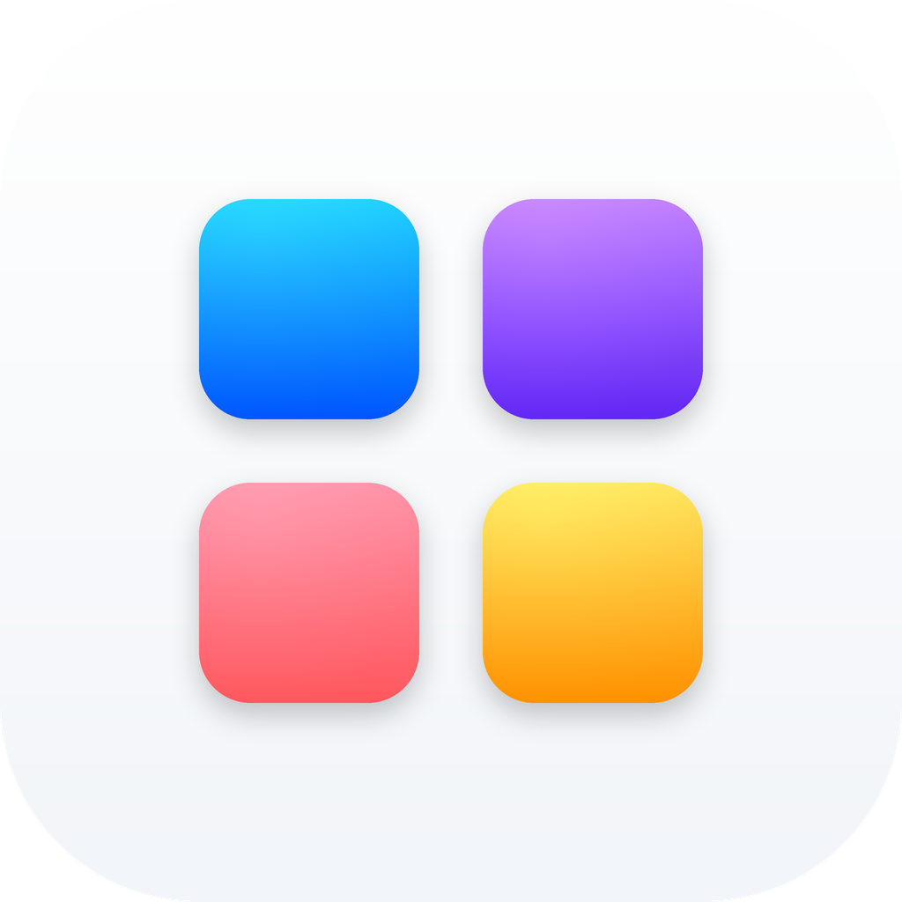
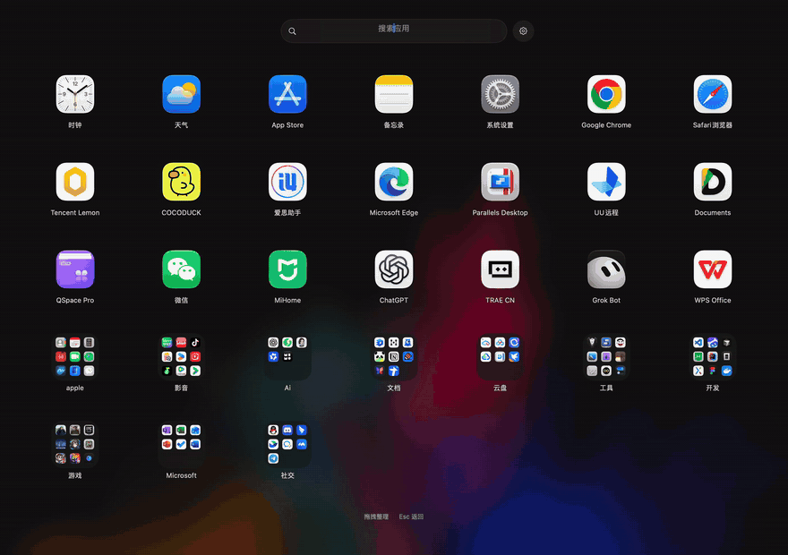
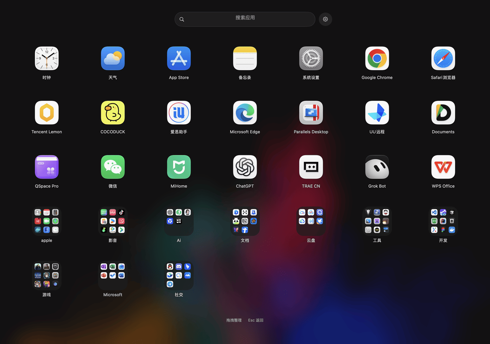
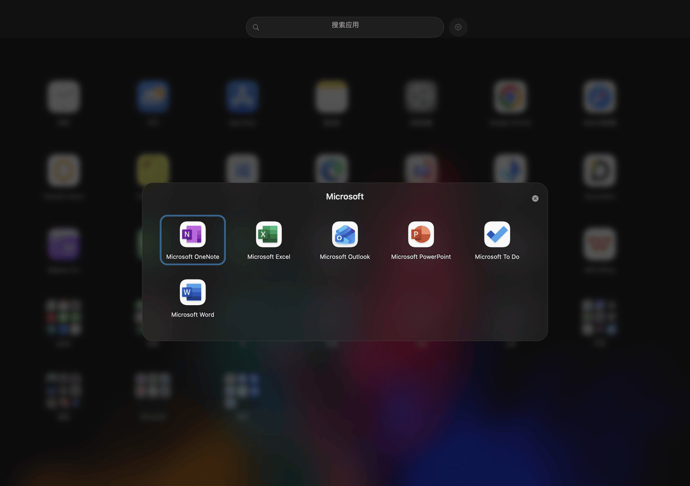
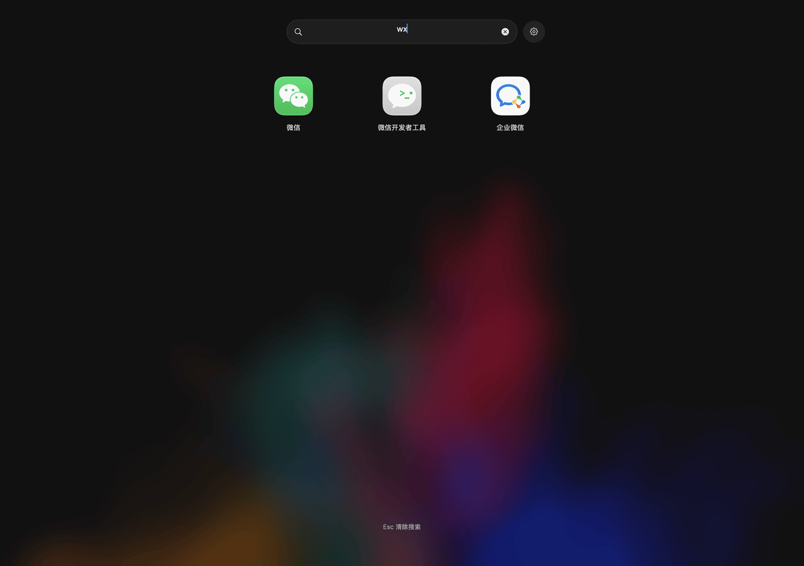
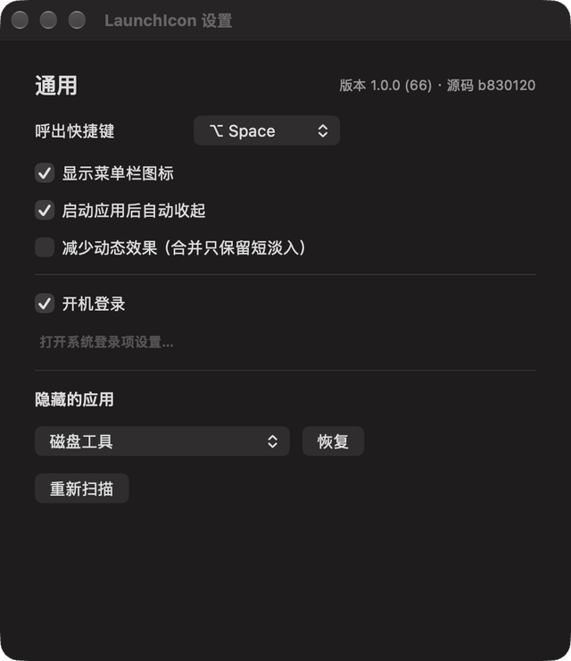

<p align="right"><a href="README.md">English</a> · <strong>简体中文</strong></p>

<p align="center">
  
</p>

<h1 align="center">LaunchIcon</h1>

<p align="center"><strong>为 macOS 26+ 做的轻量、本地优先的应用网格启动器。</strong><br>
按 <kbd>⌥ Space</kbd> 呼出 7 × 5 应用网格，用文件夹分类、拖拽整理，支持汉字、拼音全拼和首字母搜索。<br>
原生 AppKit · 无需账号 · 不联网 · 布局只存在你的 Mac 上。</p>

<p align="center">
  <a href="https://github.com/sunzhengnj/LaunchIcon-OSS/releases/tag/v1.0.0-preview.82"></a>
  <a href="https://github.com/sunzhengnj/LaunchIcon-OSS/actions/workflows/macos-validation.yml"></a>
  <a href="LICENSE"></a>
  
  
</p>

<p align="center">
  <a href="https://github.com/sunzhengnj/LaunchIcon-OSS/releases/tag/v1.0.0-preview.82"><strong>⬇ 下载（未公证预览版）</strong></a> ·
  <a href="#安装">安装</a> ·
  <a href="#已知限制">已知限制</a> ·
  <a href="#从源码构建">从源码构建</a> ·
  <a href="CONTRIBUTING.md">参与贡献</a>
</p>

<p align="center"></p>
<p align="center"><sub>使用 v1.0.0 安装包在 macOS（中文系统）上录制。<a href="Docs/Media/demo.mp4">MP4 版本</a></sub></p>

<table>
  <tr>
    <td></td>
    <td></td>
  </tr>
  <tr>
    <td align="center"><sub>应用网格与文件夹</sub></td>
    <td align="center"><sub>打开文件夹</sub></td>
  </tr>
  <tr>
    <td></td>
    <td align="center"></td>
  </tr>
  <tr>
    <td align="center"><sub>拼音搜索：<code>wx</code> → 微信</sub></td>
    <td align="center"><sub>设置（⌥ Space 快捷键、隐藏应用）</sub></td>
  </tr>
</table>

> [!NOTE]
> **早期版本，欢迎反馈**。安装包采用 ad-hoc 签名，**尚未完成 Apple 公证**（见[安装](#安装)）。本版尚未完成完整 UI 测试与连续实体输入翻页手感验收。详见[已知限制](#已知限制)。

> [!IMPORTANT]
> **当前 WIP 试用版：preview.82 / 构建78。** [下载preview.82](https://github.com/sunzhengnj/LaunchIcon-OSS/releases/tag/v1.0.0-preview.82)。公开安装包由本仓标签中的提交 `499ef93` 重新构建，已移除内部签名配置。后台验证及 CI 通过；完整 UI 与冷启动仍待验。见[源码快照说明](Docs/SOURCE_SNAPSHOT_2026-10-19.md)。

## 亮点

- **7 × 5 应用网格，支持分页**。用鼠标或键盘都能浏览。
- **文件夹与拖拽整理**。自由排序，创建和重命名文件夹，把用不到的 App 隐藏起来。
- **搜索快，中文友好**。可搜应用名称和别名；中文名称支持拼音全拼或首字母（例如 `wx` → 微信）。
- **`⌥ Space` 一键呼出**，也可以从菜单栏打开；快捷键可在设置中更换。
- **本地优先，保护隐私**。无需账号，没有云同步，不发起网络请求；布局与偏好只保存在本机。
- **原生、轻量**。基于 Swift 和 AppKit，用 macOS 公开 API 查找已安装应用，遵循“减少动态效果”设置。

## 功能

| 浏览 | 整理 | 查找 |
| --- | --- | --- |
| 7 × 5 应用网格、分页和键盘导航 | 拖拽排序、创建和重命名文件夹 | 搜索应用名称与别名 |
| 使用 macOS 公开 API 扫描已安装应用 | 布局与偏好只保存在本机 | 用拼音全拼或首字母搜索中文名称 |
| 通过 `⌥ Space` 或菜单栏打开 | 隐藏应用，并在设置中恢复 | 当前源码提供中文和英文界面 |

LaunchIcon 使用自己的视觉设计，不读取系统 Launchpad 数据库、不复制其他启动器的资源，也不需要账号或云同步。应用遵循 macOS 的“减少动态效果”设置。拼音转写使用 Foundation 的默认读音。

### preview.82 新增

- 分区设置、多选整理，以及布局重排、导出、导入与备份恢复。
- 可选热角呼出、搜索与文件夹成员结果改进、卸载保护。
- 更多“减少动态效果”即时落位路径，以及针对分页几何和时间曲线的修正；连续实体输入的翻页手感仍待验。

这些改动仍需完整 UI 和实体输入验收。**Dock / 访达随深色模式切换的 App 图标尚未实现**；已有的深色品牌图片不是 AppIcon 外观变体。

## 安装

1. 从 [preview.82 Release](https://github.com/sunzhengnj/LaunchIcon-OSS/releases/tag/v1.0.0-preview.82) 下载 `LaunchIcon-v1.0.0-preview.82-macOS-unnotarized.dmg` 和同页的 `.sha256` 文件，在两个文件所在的文件夹里核对完整性：
   ```bash
   shasum -a 256 -c LaunchIcon-v1.0.0-preview.82-macOS-unnotarized.dmg.sha256
   ```
2. 打开 DMG，把 `LaunchIcon.app` 拖进“应用程序”。替换旧版前先退出旧 App；布局与偏好保存在 App 包之外，不会丢失。
3. 先打开一次 LaunchIcon。macOS 会提示无法验证开发者，这是正常现象：App 采用 **ad-hoc 签名，尚未完成公证**。
4. 仅在确认下载来自本仓库且信任它时，打开 **系统设置 → 隐私与安全性**，滚动到“安全性”，点击 LaunchIcon 旁边的 **仍要打开**，再用密码或触控 ID 确认。从 macOS 15 起，**右键（Control-点按）→ 打开已无法绕过这个提示**。参见 [Apple 安全说明](https://support.apple.com/102445)。
5. LaunchIcon启动时默认显示主界面；用`⌥ Space`或菜单栏图标收起/呼出。

请不要关闭 Gatekeeper，也不要运行来源不明的解除隔离命令。如果不想运行未公证的安装包，可以用 Xcode [从源码构建](#从源码构建)。

## 已知限制

- 安装包是 ad-hoc 签名，没有 Developer ID 签名，也没有经过 Apple 公证。
- preview.82 未运行完整 UI 测试，也未对公开 DMG 做隔离冷启动。
- 连续实体翻页、跨页拖拽、VoiceOver、大文件夹和 Dock / 访达深色图标仍待验。

- 需要 macOS 26 或更高版本。

## 从源码构建

**环境要求：** macOS 26 或更新版本、Xcode 27 及对应 SDK。

```bash
git clone https://github.com/sunzhengnj/LaunchIcon-OSS.git
cd LaunchIcon-OSS
./script/validate_background.sh
```

在 Xcode 中打开 `LaunchIcon.xcodeproj`，为签名配置你自己的 Apple 开发团队。仓库不包含维护者的 Team ID、证书或公证凭据。

后台质量门会运行网络 API 静态守卫、Core 测试、Direct 与 StoreSpike 的 Release 分析，以及 UI 测试目标编译。**它不会启动 App 或运行完整 UI 测试。**可见测试会占用桌面，只能在电脑使用者同意的时段运行：

```bash
LAUNCHICON_ALLOW_VISIBLE_TESTS=1 ./script/test_direct_bootstrap.sh
```

`StoreSpike` 仅用于验证沙箱可行性，不是 App Store 正式版。预览包与正式签名的脚本入口分别在 `script/package_preview.sh` 和 `script/distribution_preflight.sh`。

## 项目状态

| 范围 | 当前证据 |
| --- | --- |
| Core 与构建 | 公开检出后台门与 PR CI 通过：本地 Core 309/309、双渠道 Release 分析和 UI 目标编译。见[测试矩阵](Docs/TEST_MATRIX.md)。 |
| 完整 UI | preview.82 未运行完整 UI 或隔离冷启动；连续实体翻页手感未验收。 |
| 发布 | [preview.82](https://github.com/sunzhengnj/LaunchIcon-OSS/releases/tag/v1.0.0-preview.82)为WIP预发布、ad-hoc签名、未公证；发布说明记录包身份、校验和回下载结果；没有新的可见 UI/冷启动结论。 |
| 待验 | 实体拖拽、大文件夹、逐个目标应用启动、VoiceOver、Store 沙箱和 Dock/访达深色图标。 |

CI 徽章**只代表后台质量门**，不表示完整 UI 或发布验收通过。详见[测试矩阵](Docs/TEST_MATRIX.md)与[源码快照说明](Docs/SOURCE_SNAPSHOT_2026-10-19.md)。

## 参与贡献

欢迎提交 Issue 和 Pull Request。改代码前请阅读 [CONTRIBUTING.md](CONTRIBUTING.md) 与 [AGENTS.md](AGENTS.md)。改动应对应已记录的需求或可复现 bug；汇报时分开写明 Core、UI 与安装包的验证结果。反馈问题请附应用版本、macOS 版本、芯片和复现步骤，并从日志、崩溃报告、布局与偏好文件中移除个人信息。

日常开发在维护者的另一个仓库进行；本公开仓接收经审查的发布版本和明确标记的源码快照。见[同步规则](Docs/SYNC_FROM_PRIVATE.md)。

## 许可证

代码与文档采用 [Apache License 2.0](LICENSE)，参见 [NOTICE](NOTICE)。LaunchIcon 名称和品牌图样用于标识本项目，许可证不自动授予商标使用权。LaunchIcon 不是 Apple Launchpad 的克隆。
